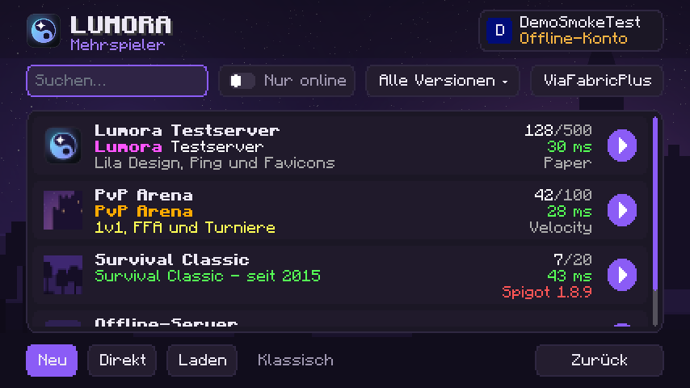
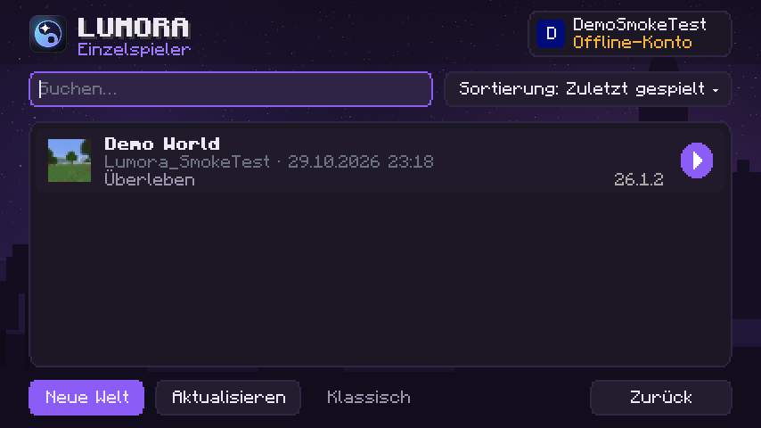

# Lumora Server- & Weltliste

Eigene Mehrspieler- und Einzelspieler-Menüs: Kontokarte, Suche, „Nur online“, Versionsfilter, Serverkarten mit Icon, farbiger MOTD, Spielern, Version und Ping; Hinzufügen, Bearbeiten, Sortieren, Direkt verbinden; Weltkarten mit Modus, Version und „zuletzt gespielt“, Löschen mit Bestätigung. „Klassisch“ öffnet das Vanilla-Menü (auch für ViaFabricPlus). Nutzt Minecrafts eigene `servers.dat`.

Eingebautes Addon des Lumora Clients (Id `lumora-browser`, im Spiel: Lumora-Hub → Addons). Läuft in allen 18
unterstützten Minecraft-Versionen (1.8.9 bis 26.3). Standard: **an**.

> Dieses Repository ist eine **Kopie zum Lesen und Nachschlagen**. Das Addon ist Teil des Clients, weil es an
> Minecraft-Stellen andockt, die sich je Version unterscheiden. Gebaut, getestet und ausgeliefert wird es in
> [LumoraClient/lumora-launcher](https://github.com/LumoraClient/lumora-launcher). Eigene Addons baust du mit dem
> [Addon-Template](https://github.com/LumoraClient/lumora-addon-template).

## Einstellungen

| Schlüssel | Bedeutung |
|---|---|
| `multiplayer` | Lumora-Serverliste statt Mehrspieler-Menü |
| `singleplayer` | Lumora-Weltliste statt Einzelspieler-Menü |

## Aufbau

| Ordner | Inhalt | Im Haupt-Repository |
|---|---|---|
| `src/` | Das Addon (versionsunabhängig, nur Lumora-API und Lumora-Core) und die gemeinsamen Helfer, die es braucht | `lumora-core/src/main/java/dev/lumora/core/` |
| `hooks/<version>/` | Die Andockstellen je Minecraft-Version (Mixins und Adapter) | `client/mc<version>/src/main/java/dev/lumora/client/` |
| `tests/` | Unit-Tests (laufen im Haupt-Repository) | `lumora-core/src/test/java/` |

## Lizenz

GPL-3.0-or-later (siehe `LICENSE`), wie der ganze Lumora Client.

Aufbau angelehnt an das Mehrspieler-Menü von LiquidBounce (nur Gestaltung, kein Code). Server List Ping nach der öffentlichen Protokollbeschreibung.
